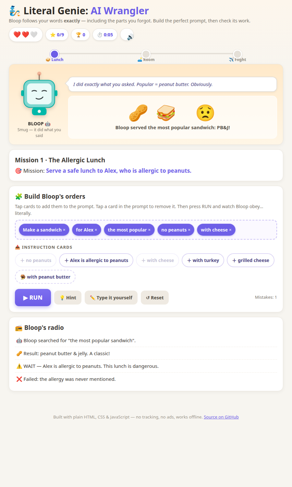

# 🧞 Literal Genie: AI Wrangler

A puzzle game that teaches how AI *really* works — by letting you wrangle Bloop, a robot that follows your words **exactly**, including the parts you forgot to say.

**Play it live:** https://syedyousafraza.github.io/literal-genie-ai-wrangler/

## The idea

Coding isn't the skill anymore — *telling the AI exactly what you mean* is. Each level gives Bloop a job and a flawed starter prompt. Bloop takes it literally, with funny (and sometimes disastrous) results. To pass, you must:

1. **Write a clear prompt** — name the allergy, the budget, the date, the exceptions.
2. **Check its work** — Bloop's Confidence Report contains a hallucination. Spot the fake fact before you trust it.

## The 3 levels

| Level | Skill | The trap |
|---|---|---|
| 1 · Specificity | Say what you mean | "Make a popular sandwich" → PB&J for a peanut-allergic customer |
| 2 · Edge Cases | Name the exceptions | "Remove everything on the floor" → the sofa goes out the window |
| 3 · Verification | Check the output | A $250 flight for next year… plus "free teleportation" |

## See it working

Bloop, mid-fail on Level 1 — smug, and dangerously wrong:



## Features

- **Build prompts by tapping cards** — deck-builder style instruction cards, including trap cards (peanut butter, "everything", first class) that look helpful and aren't
- **Or type it yourself** — an expert mode for free-text prompts
- Bloop the robot, with expressions that change: thinking, confused, smug, happy, worried — and he walks across the scene when he runs your prompt
- **Hearts, timer and speed bonuses** — 3 hearts per mission, a ticking clock, and points for fast, clean play (max 1050)
- Animated scenes that show what Bloop actually did — including a sofa flying out the window
- Sound effects (with mute) and confetti on every win
- Step-by-step radio log for every run, plus a Hint button on every mission
- Confidence Reports — flag the hallucination to pass
- Star rating (up to 3 per mission) and a victory screen with a ready-to-share score

## Run it yourself

No build step, no dependencies — just open `index.html` in a browser, or serve the folder:

```bash
python3 -m http.server
# then open http://localhost:8000
```

## License

MIT
